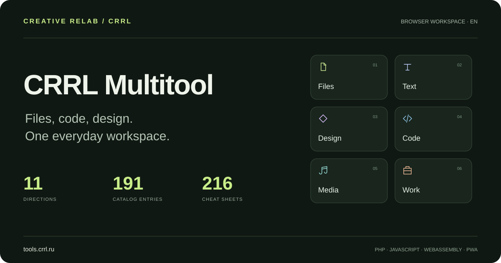
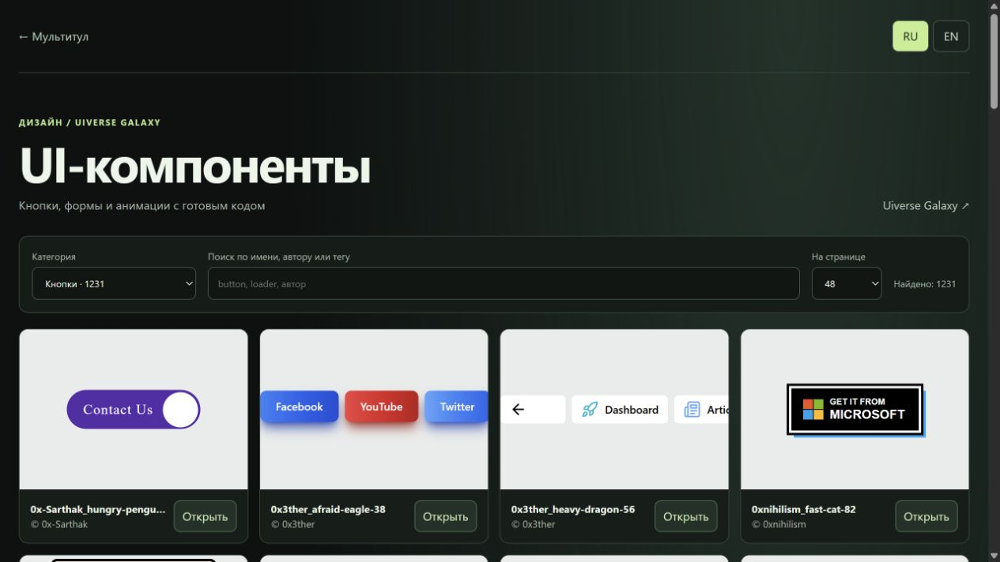
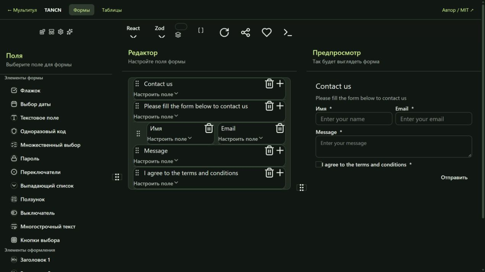
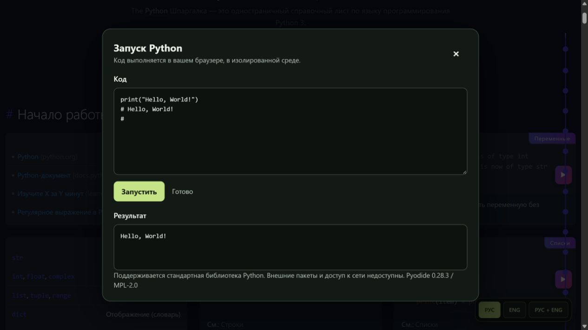
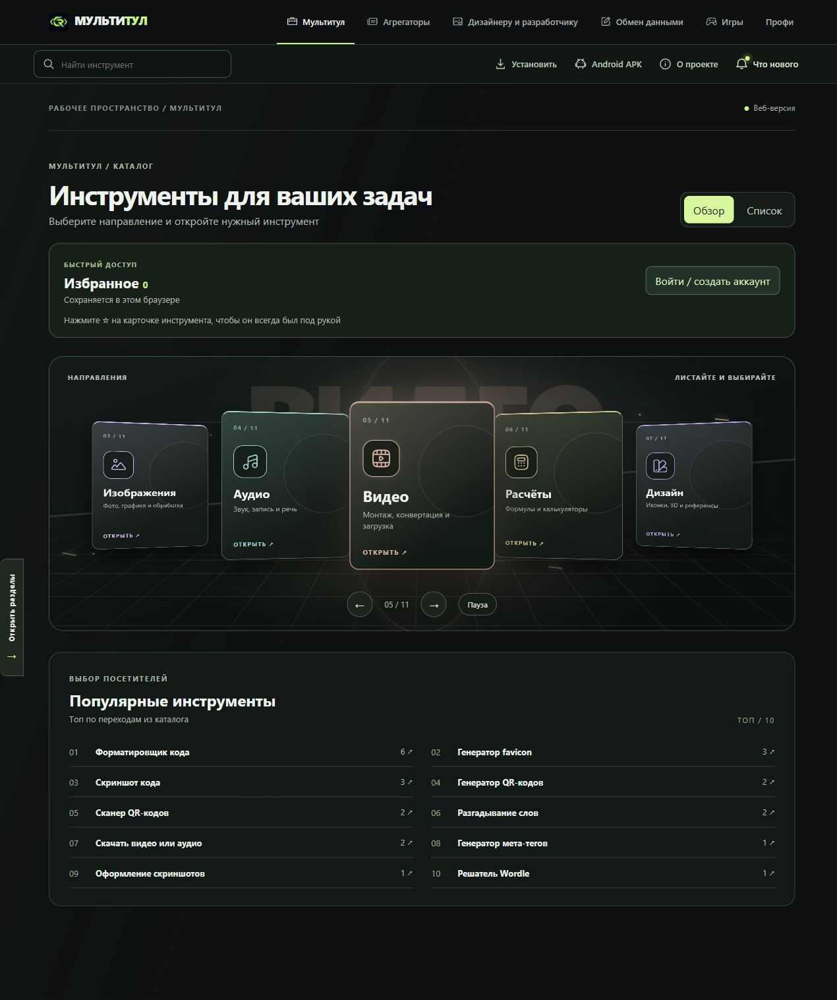

<a href="README.md">Русский</a> · <strong>English</strong>

<a href="https://tools.crrl.ru/"><strong>Open Multitool</strong></a> · <a href="#sections-and-capabilities">Sections</a> · <a href="#who-it-is-for">Who it is for</a> · <a href="docs/DEPLOYMENT.en.md">Self-hosting</a> · <a href="docs/THIRD_PARTY.md">Credits and licenses</a>

# CRRL Multitool

**A browser workspace for files, text, media, design and development.**

Multitool brings practical utilities, reference materials and visual editors together under shared navigation. Prepare a document, process an image, look up a code example, build a form or transfer a file, then keep frequently used tools in favorites.

The project focuses on everyday work. Most operations run in the browser, while PHP provides selected site services. Some features rely on external libraries, models, network services or separately configured server processes.

| Directions | Base catalog | Cheat sheets |
| :---: | :---: | :---: |
| **11** | **191 entries** | **216 materials** |

These figures describe the [repository snapshot dated 16 November 2026](docs/catalog-snapshot.json). Additional modules are listed separately. Catalog entries have different runtime and offline requirements.

## Who it is for

| Audience | Practical use cases |
| --- | --- |
| **Content and marketing professionals** | Prepare images and PDFs, extract text, process audio, organize publications and RSS sources, and draft content. |
| **Designers and interface creators** | Find SVG icons and UI components, work with palettes and graphics, inspect HTML/CSS and copy reusable examples. |
| **Developers** | Browse cheat sheets, run examples in an in-page editor, transform data, build forms and tables, and compare files. |
| **Students, educators and parents** | Use reference materials, calculators, educational games, interactive experiments, a CPU emulator and Morse tools. |
| **Freelancers and small teams** | Handle recurring document tasks, exchange materials and access a shared collection of utilities. |
| **Technical specialists** | Check DNS through public resolvers, inspect metadata and prototype business applications. |

## Sections and capabilities

### Multitool: 11 directions

| Direction | Included capabilities |
| --- | --- |
| **Files** | PDF merging and splitting, watermarks, ZIP archives, supported conversions, metadata inspection and removal. |
| **Text** | Notepad, Markdown, text comparison, case conversion, word and character counts, OCR and related utilities. |
| **Images** | Resize and format conversion, compression, cropping, color adjustments, watermarks, background removal and HTML Paint. |
| **Audio** | Recording and playback, audio extraction from video, transcription on supported devices, Morse decoding and generation. |
| **Video** | Supported format conversion, trimming, GIF creation and audio extraction. Downloading through ReClip requires a separate service. |
| **Calculations** | Standard and scientific calculations, measurement units, age, dates, aspect ratios and practical calculators. |
| **Design** | SVG icons, color tools, UI components, interface references and access to the Sand3D object catalog. |
| **AI** | Prompt tools, instruction comparison and selected text or media operations. Model availability depends on resource downloads and device capabilities. |
| **Development** | Code formatting, JSON/YAML, Base64, regular expressions, barcodes, reference materials and a CPU emulator. |
| **Games** | An index of open-source game projects, educational games and pixel effects. Installation and execution depend on each project. |
| **Work** | Event timelines, clocks, timers, charts and utilities for organizing everyday tasks. |

### Dedicated workspaces

| Workspace | Purpose |
| --- | --- |
| **[Aggregators](https://tools.crrl.ru/#news)** | Publication search, custom RSS/Atom sources, collections and draft editing. Organization search depends on a separate backend. |
| **[Design and development](https://tools.crrl.ru/#catalogs)** | Themed collections, locally hosted UI components, cheat sheets and builders. |
| **[Data sharing](https://tools.crrl.ru/#notes)** | PrivateBin encrypted notes, temporary image links and file transfers through DashBeam. The DashBeam web client uses public relays. |
| **[Pro](https://tools.crrl.ru/pro/)** | DNS checks, document and scan workflows, and BAP Studio for business applications with tables, forms and reports. |

## Featured tools

| Module | Capabilities |
| --- | --- |
| **[TANCN](https://tools.crrl.ru/tancn/)** | Visual form and table building: a field library, templates, live previews and component export. Projects are stored in the browser; a PHP registry serves generated CLI links. |
| **[UI components](https://tools.crrl.ru/ui-components/)** | Uiverse community components with filters, interactive previews and a code viewer. Author credits remain in cards and source files. |
| **[Cheat sheets](https://tools.crrl.ru/reference/)** | Russian explanations, original text or both. Code and command names are preserved. Language controls remain available while scrolling. |
| **In-page code execution** | Python, JavaScript, TypeScript, PHP, SQL, Ruby, Go and C++ have been exercised in the editor. HTML/CSS examples support visual previews. |
| **[HTML Paint](https://tools.crrl.ru/market-apps/paint/)** | An image editor with layers, drawing tools, adjustments and effects. |
| **[BAP Studio](https://tools.crrl.ru/market-apps/bap/)** | Build directories, documents, forms and reports, with browser or file storage. |
| **[File comparison](https://tools.crrl.ru/market-apps/merge/)** | Compare files and folders and inspect differences in text and code. |
| **[Educational games](https://tools.crrl.ru/market-apps/school/)** | Reading and mathematics exercises, English practice and interactive experiments. Interface languages: Russian and Ukrainian. |

## Navigation and workflow

- **Global search** finds tools by name or task without opening each section.
- **Favorites** are stored locally. Simple username profiles can synchronize the list; password-free access is a convenience feature and does not verify ownership of a username.
- **Popular tools** reflect catalog clicks rather than all application traffic.
- **What's new** records the date, section and details of additions.
- **PWA installation** adds the site shell to a device. Offline availability depends on the utility and resources already downloaded. The Android APK is published as a test version.

## Interface

<table>
<tr><td width="50%"><strong>UI component library</strong> </td><td width="50%"><strong>TANCN form builder</strong> </td></tr>
<tr><td colspan="2"><strong>Run examples inside the workspace</strong> </td></tr>
</table>

Home page and catalog directions

Screenshots show the working application. An English project overview does not imply a complete English translation of every integrated third-party interface.

## Self-hosting

This repository includes PHP files and prepared browser builds. Node.js is not required to rebuild those assets for deployment. The application expects a dedicated domain root; a subdirectory deployment requires path changes and rebuilding selected modules.

1. Clone the repository: `git clone https://github.com/upe4d/crrl-multitool.git`.
2. Follow the [deployment guide](docs/DEPLOYMENT.en.md) for PHP, HTTPS, PrivateBin, protected storage and web-server rules.
3. Configure additional services for the features you intend to use.

| Path | Contents |
| --- | --- |
| **`index.html`, `directions/`, `pwa/`** | Shell, catalog, global search, updates and PWA. |
| **`browsery/`, `browsery-extra/`** | Prepared browser utilities. |
| **`reference/`, `code-playground/`** | Cheat sheets and the example execution environment. |
| **`tancn/`, `ui-components/`, `market-apps/`** | Builders, components and integrated applications. |
| **`api/`, `n/`, `i/`, `dashbeam/`** | PHP services, notes and data sharing. |
| **`docs/`, `licenses/`** | Documentation, presentation assets and licenses. |

## Current boundaries

Cheat-sheet explanations use machine translation. AI generation in TANCN requires a separately configured model API. Swift, Kotlin and Rust currently have no executable runtime in this installation. ACE Music remains an external service; Gitmsg is marked as in development. Server-side conversion, organization search and some AI features require more than ordinary PHP hosting.

## Credits and licenses

Multitool combines the CRRL application shell with third-party projects while preserving attribution. Component-specific licenses include MIT, GPL, AGPL and other terms. Project references, license locations and available source archives are listed in [THIRD_PARTY.md](docs/THIRD_PARTY.md).

**Development and integration:** [Creative Relab](https://crrl.ru/) · [GitHub](https://github.com/upe4d) · [Contact](https://t.me/creativerelab).
