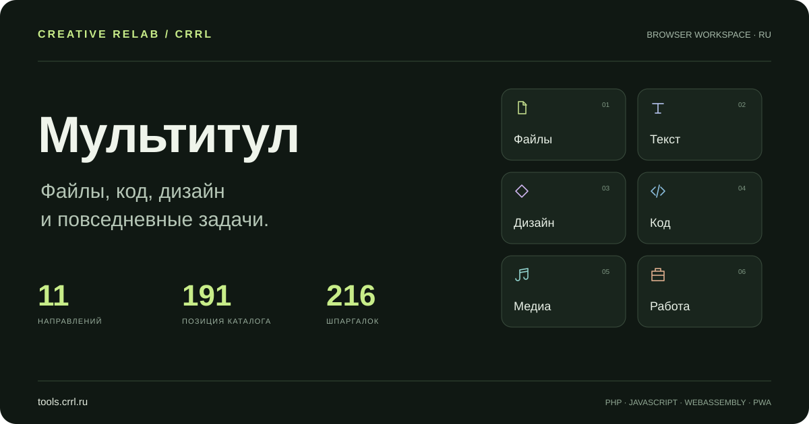
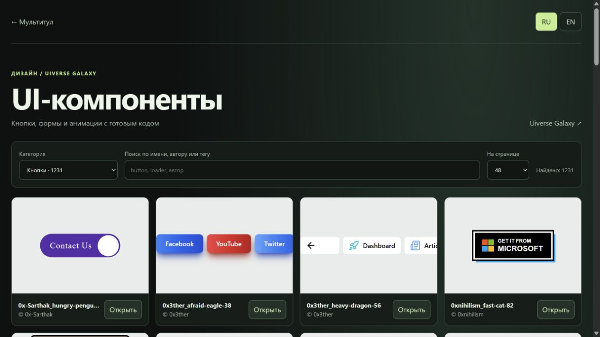
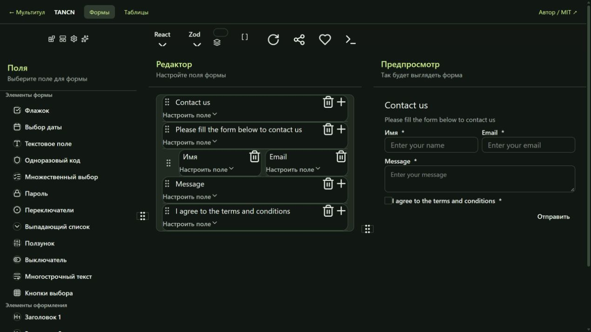
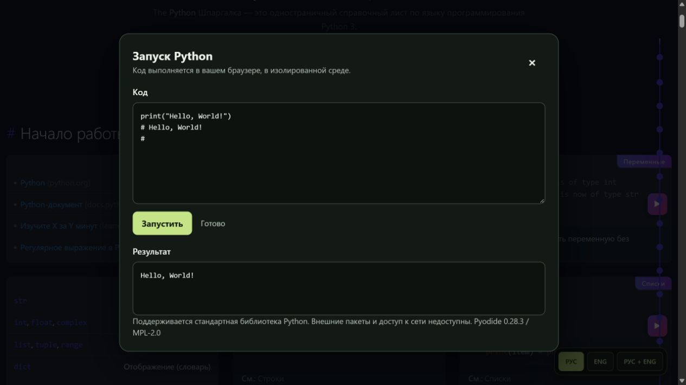
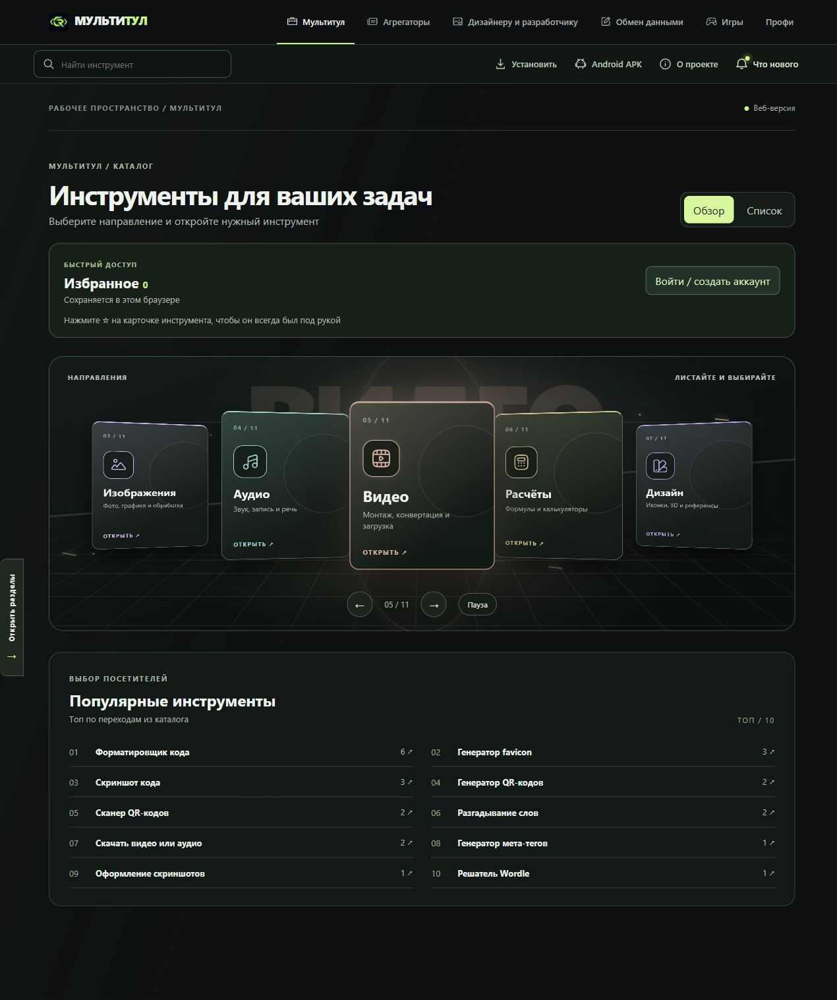

<strong>Русский</strong> · <a href="README.en.md">English</a>

<a href="https://tools.crrl.ru/"><strong>Открыть Мультитул</strong></a> · <a href="#разделы-и-возможности">Разделы</a> · <a href="#кому-подойдёт">Для кого</a> · <a href="docs/DEPLOYMENT.ru.md">Своя установка</a> · <a href="docs/THIRD_PARTY.md">Авторы и лицензии</a>

# Мультитул CRRL

**Рабочее пространство в браузере для файлов, текста, медиа, дизайна и разработки.**

Мультитул объединяет прикладные утилиты, справочники и визуальные редакторы под общей навигацией. Здесь можно подготовить документ, обработать изображение, найти пример кода, собрать форму или передать файл, сохранив часто используемые инструменты в избранное.

Проект рассчитан на повседневные рабочие задачи. Основная часть операций выполняется в браузере; PHP обслуживает отдельные функции сайта. Некоторые возможности используют внешние библиотеки, модели, сетевые службы или отдельно настроенные серверные процессы.

| Направления | Базовый каталог | Шпаргалки |
| :---: | :---: | :---: |
| **11** | **193 позиции** | **216 материалов** |

Числа отражают [снимок состава от 16 ноября 2026 года](docs/catalog-snapshot.json). Дополнительные модули перечислены отдельно; позиции каталога имеют разные требования к запуску и автономной работе.

## Кому подойдёт

| Аудитория | Практические сценарии |
| --- | --- |
| **Специалисты по контенту и маркетингу** | Подготовка изображений и PDF, извлечение текста, обработка аудио, подборки публикаций и RSS, текстовые заготовки. |
| **Дизайнеры и авторы интерфейсов** | Поиск SVG-иконок и UI-компонентов, палитры и графика, просмотр HTML/CSS и копирование примеров. |
| **Разработчики** | Шпаргалки, исполнение примеров в попапе, преобразование данных, конструкторы форм и таблиц, сравнение файлов. |
| **Студенты, преподаватели и родители** | Справочные материалы, калькуляторы, учебные игры, наглядные опыты, эмулятор процессора и азбука Морзе. |
| **Фрилансеры и небольшие команды** | Повторяющиеся операции с документами, передача материалов и быстрый доступ к общему набору утилит. |
| **Технические специалисты** | Проверка DNS через публичные резолверы, анализ метаданных и прототипирование бизнес-приложений. |

## Разделы и возможности

### Мультитул: 11 направлений

| Направление | Что находится внутри |
| --- | --- |
| **Файлы** | Объединение и разделение PDF, водяные знаки, ZIP-архивы, поддерживаемые конвертации, просмотр и удаление метаданных. |
| **Текст** | Блокнот, Markdown, сравнение текстов, изменение регистра, подсчёт символов и слов, OCR и вспомогательные текстовые операции. |
| **Изображения** | Изменение размера и формата, сжатие, обрезка, цветокоррекция, водяные знаки, удаление фона и редактор HTML Paint. |
| **Аудио** | Запись и воспроизведение, извлечение звука из видео, транскрибация на поддерживаемом устройстве, декодер и генератор Морзе. |
| **Видео** | Конвертация поддерживаемых форматов, обрезка, GIF и извлечение аудио. Загрузка через ReClip требует отдельного сервиса. |
| **Расчёты** | Научные и обычные вычисления, единицы измерения, возраст, даты, соотношения сторон и прикладные калькуляторы. |
| **Дизайн** | SVG-иконки, цветовые инструменты, UI-компоненты, референсы интерфейсов и доступ к каталогу 3D-объектов Sand3D. |
| **ИИ** | Инструменты для промптов, сравнения инструкций и работы с текстом или медиа. Доступность моделей зависит от загрузки ресурсов и устройства. |
| **Разработка** | Форматирование кода, JSON/YAML, Base64, регулярные выражения, штрихкоды, справочники и эмулятор процессора. |
| **Игры** | Каталог проектов с открытым кодом, учебные игры и пиксельные эффекты. Установка и запуск игр зависят от конкретного проекта. |
| **Работа** | Временная шкала событий, часы и таймеры, диаграммы и инструменты для организации повседневных задач. |

### Отдельные рабочие области

| Область | Назначение |
| --- | --- |
| **[Поиск и загрузка](https://tools.crrl.ru/#news)** | Поиск публикаций, собственные RSS/Atom-источники, подборки и редактор черновиков. Поиск организаций зависит от отдельного сервера. |
| **[Дизайнеру и разработчику](https://tools.crrl.ru/#catalogs)** | Тематические подборки, локальные UI-компоненты, шпаргалки и конструкторы. |
| **[Обмен данными](https://tools.crrl.ru/#notes)** | Защищённые заметки PrivateBin, временные ссылки на изображения и передача файлов через DashBeam. Веб-клиент DashBeam использует публичные реле. |
| **[Профи](https://tools.crrl.ru/pro/)** | Проверка DNS, работа с документами и сканами, BAP Studio для бизнес-приложений с таблицами, формами и отчётами. |

## Инструменты, которые стоит посмотреть

| Модуль | Возможности |
| --- | --- |
| **[TANCN](https://tools.crrl.ru/tancn/)** | Визуальное создание форм и таблиц: библиотека полей, шаблоны, предпросмотр и экспорт компонентов. Проекты сохраняются в браузере; CLI-ссылки обслуживаются PHP-реестром. |
| **[UI-компоненты](https://tools.crrl.ru/ui-components/)** | Компоненты сообщества Uiverse: фильтры, интерактивный предпросмотр и окно просмотра кода. Авторство сохраняется в карточках и исходниках. |
| **[Шпаргалки](https://tools.crrl.ru/reference/)** | Русский перевод, оригинал или оба варианта пояснений. Код и имена команд сохраняются. Переключатель языка доступен при прокрутке. |
| **Запуск примеров** | Редактор внутри страницы: проверены Python, JavaScript, TypeScript, PHP, SQL, Ruby, Go и C++. Для веб-примеров доступен предпросмотр HTML/CSS. |
| **[HTML Paint](https://tools.crrl.ru/market-apps/paint/)** | Графический редактор со слоями, инструментами рисования, коррекцией и эффектами. |
| **[BAP Studio](https://tools.crrl.ru/market-apps/bap/)** | Конструктор справочников, документов, форм и отчётов с хранением в браузере или файле. |
| **[Сравнение файлов](https://tools.crrl.ru/market-apps/merge/)** | Сопоставление файлов и папок, поиск различий в тексте и коде. |
| **[Учебные игры](https://tools.crrl.ru/market-apps/school/)** | Чтение, математика, упражнения по английскому и интерактивные опыты. Языки интерфейса: русский и украинский. |

## Навигация и рабочий процесс

- **Общий поиск** находит инструмент по названию и задаче без обхода разделов.
- **Избранное** сохраняется локально; простые профили по логину позволяют синхронизировать список. Вход без пароля предназначен для удобства и не подтверждает личность владельца логина.
- **Популярные инструменты** отражают переходы из каталога, а не все посещения приложения.
- **«Что нового»** показывает дату, раздел и содержание добавлений.
- **PWA** позволяет установить оболочку сайта. Автономная доступность зависит от инструмента и загруженных ресурсов. Android APK опубликован как тестовая версия.

## Интерфейс

<table>
<tr><td width="50%"><strong>Каталог UI-компонентов</strong> </td><td width="50%"><strong>Конструктор форм TANCN</strong> </td></tr>
<tr><td colspan="2"><strong>Запуск примеров внутри сайта</strong> </td></tr>
</table>

Главная страница и каталог направлений

Скриншоты сняты с работающего сайта. Английская версия описания не означает, что каждый сторонний инструмент полностью переведён на английский язык.

## Своя установка

В репозитории находятся PHP-файлы и подготовленные браузерные сборки. Для их размещения пересборка Node.js не требуется. Приложение рассчитано на корень отдельного домена; перенос в подпапку требует изменения путей и пересборки отдельных модулей.

1. Получите репозиторий: `git clone https://github.com/upe4d/crrl-multitool.git`.
2. Откройте [инструкцию размещения](docs/DEPLOYMENT.ru.md): PHP, HTTPS, PrivateBin, защищённое хранение и правила веб-сервера.
3. Настройте дополнительные сервисы для тех функций, которые планируете использовать.

| Путь | Содержимое |
| --- | --- |
| **`index.html`, `directions/`, `pwa/`** | Оболочка, каталог, общий поиск, обновления и PWA. |
| **`browsery/`, `browsery-extra/`** | Подготовленные браузерные утилиты. |
| **`reference/`, `code-playground/`** | Шпаргалки и среда исполнения примеров. |
| **`tancn/`, `ui-components/`, `market-apps/`** | Конструкторы, компоненты и встроенные приложения. |
| **`api/`, `n/`, `i/`, `dashbeam/`** | PHP-функции, заметки и обмен данными. |
| **`docs/`, `licenses/`** | Документация, визуальные материалы и лицензии. |

## Текущие границы

Перевод пояснений в шпаргалках автоматический. ИИ-генерация TANCN требует отдельно подключённого API. Swift, Kotlin и Rust пока не исполняются в установленной среде. ACE Music остаётся внешним сервисом, а Gitmsg отмечен как проект в разработке. Для серверных конвертаций, поиска организаций и некоторых ИИ-функций одного PHP-хостинга недостаточно.

## Авторы и лицензии

Мультитул объединяет собственную оболочку CRRL и сторонние проекты с сохранением авторства. Лицензии применяются к соответствующим компонентам: в составе есть MIT, GPL, AGPL и другие условия. Проекты, лицензии и доступные архивы исходников перечислены в [THIRD_PARTY.md](docs/THIRD_PARTY.md).

**Разработка и интеграция:** [Creative Relab](https://crrl.ru/) · [GitHub](https://github.com/upe4d) · [Связаться](https://t.me/creativerelab).

## Игры в браузере и виртуальная компьютерная среда

[Играть на Мультитуле](https://tools.crrl.ru/games/) — **173 локальные игры** в 12 жанрах со счётчиками, поиском и общим избранным. Коллекции: 106 Mini Browser Games, 64 игры «Ночной ярмарки» и 3 игры настольной комнаты. В настольной комнате — полноценный бильярд против компьютера или друга, домино и русские шашки. Все запускаются на нашем сайте.

Оригинальное оформление импортированных игр сохранено. Словари всех 64 игр Night Fair переписаны вручную; у 106 Mini Games отредактированы инструкции и 382 общих термина. Длинные сюжетные тексты Mini Games ещё могут содержать неточности. Night Fair включает русские слова, клавиатуру и задания для печати. Версии, авторство и лицензии: [games/credits.html](games/credits.html), [sources.json](games/sources.json). Архивные игры и настольные клиенты Mini Browser Games не включены.

[Aurora OS.js](https://tools.crrl.ru/pro/aurora/) размещена в «Профи»: экспериментальная компьютерная среда с рабочим столом, терминалом и виртуальными файлами. Версия 0.8.5, pre-alpha. Сюжетная игра и MMO находятся в планах автора. [Исходники размещённой сборки](https://tools.crrl.ru/pro/aurora/aurora-source.tar.gz), AGPL-3.0.
